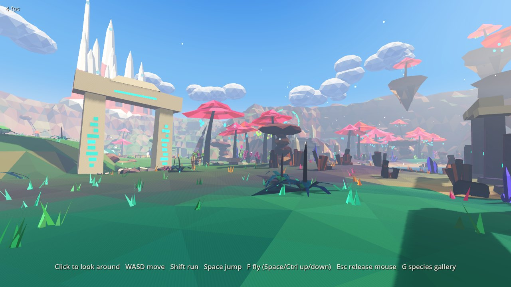
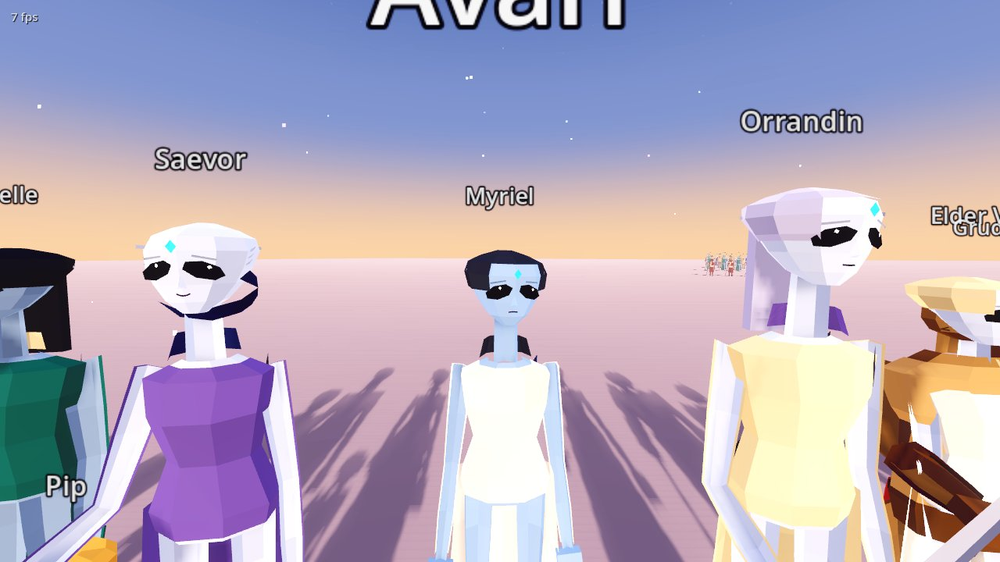

# Alien Planet: environment prototype

A small, explorable, low-poly alien world. It is made procedurally in **Blender** and played in **Godot 4.6** (Compatibility renderer, so it runs on mobile). There is no gameplay yet. This prototype is only the world and its look.



## What's in it
- **Terrain:** a ~180 m explorable bowl enclosed by terraced, strata-banded cliffs. It also has four stepped mesas, wind-carved ridges and a lake basin with a sandy shelf.
- **Unusual landforms:** **floating rock islands** with plants on top (they bob slowly), a huge **natural rock arch**, a **hexagonal basalt column field**, curved **thorn spires** and balanced **hoodoo** stacks.
- **Alien vegetation:**
  - magenta/coral **parasol trees** with hanging bioluminescent seed bulbs
  - **bulb pods**, teal **fan fronds** and amber **tube coral**
  - **lantern stalks** and **glowing crystal clusters**
  - tri-colour grass tufts
  - all plants sway in the wind on the GPU
- **Ancient ruins:**
  - a **ring shrine** on the temple mesa: a broken standing stone ring with a floating glowing core, a monolith circle and grand stairs
  - a ruined **colonnade** with fallen pillars
  - a half-sunk **gateway**
  - glyph-lit **monoliths** and wall fragments
- **Water:** stylised low-poly lake water that matches the faceted world. It has a gently rolling faceted surface, sparkling sun glints and a soft sky reflection. It is clearly transparent: the sandy bed, rocks, weed, coral and crystals show through, tinted from turquoise to deep blue with depth. Crisp foam rings lap the shore and the coral that breaks the surface.
- **Sky:** a bright late-morning sky, a sun with a halo, a small moon, and big low-poly cumulus clouds (unshaded, no fog). The sky itself is one analytic shader with no textures.
- **Atmosphere:** height + distance fog with sun scatter, soft glow on emissives, drifting spore particles and baked ambient occlusion.

## Explore it
Open `alien_planet/godot/` in Godot 4.6 and press Play.

| | Desktop | Touch |
|---|---|---|
| Move | WASD / arrows (Shift = run) | left-side floating stick (push to the edge to run) |
| Look | click to capture the mouse, then move it (Esc releases) | drag on the right side |
| Jump | Space | JUMP |
| Fly camera | F (Space/Ctrl = up/down) | FLY (JUMP = rise) |

**Android:** run `tools/build_apk.sh --setup` once to install the SDK, templates and debug keystore. Then `alien_planet/build_apk.sh` produces `dist/alien-planet-debug.apk`, which you can sideload with `adb install -r`.

## Pipeline
```
python3 alien_planet/blender/build_world.py     # (pip bpy 5.x) or: blender -b -P alien_planet/blender/build_world.py
  -> alien_planet/blender/alien_world.blend      open/inspect/edit in Blender (camera is at the spawn point)
  -> alien_planet/godot/assets/world.glb         loaded by Godot at runtime
alien_planet/shots.sh OUTDIR [WxH] [--touch]    renders the screenshot gallery headlessly
```
- `blender/build_world.py` holds the whole world: layout constants at the top, then terrain, rocks, flora, ruins, floating islands, scatter, the AO bake and the export. The seed is fixed, so builds are reproducible. A full build takes about 2 s.
- `godot/scripts/main.gd` sets up materials, collision, sky/sun/fog, the lake and the explorer. `explorer.gd` is the first-person controller. `touch_controls.gd` holds the touch stick and buttons plus the HUD.
- `godot/shaders/`:
  - `solid` for terrain, rocks and ruins
  - `flora` for sway and leaf translucency
  - `glow` for unshaded pulsing emissives
  - `water` for the transparent lake (waves, depth tint, foam)
  - `sky` for the dusk sky

### Naming conventions (Blender object → Godot behaviour)
| Prefix | Behaviour |
|---|---|
| `Terrain`, `Rock_*`, `Ruin_*` | trimesh collision |
| `Flora_*` | wind sway (UV.x = sway weight, UV.y = phase), no collision |
| `Deco_*` | non-solid stone: stair treads over a ramp, rubble, glyphs |
| `Detail_*` | grass tufts, hidden beyond 48 m, no shadows |
| `Float_*` | floating islands; `Float_core` spins above the shrine with a light |

## Mobile budget (current)
- ~70k triangles in the whole world, in 58 merged objects chunked on a 4×4 grid so the engine can frustum-cull them.
- Typically 50–150 draw calls per frame, shadow pass included.
- No textures at all. Colour is per-face vertex colour, and ambient occlusion is baked into it, so it costs nothing at runtime.
- 5 shader materials plus the water (one transparent ~13k-triangle plane, which reads the depth buffer), 1 shadowed directional light (2 cascades, 80 m), 1 unshadowed fill light and 1 omni light.
- The sky is static, so its radiance and ambient are computed once.
- Not yet profiled on a real device. Levers if needed: `directional_shadow_max_distance`, the `Detail_` visibility range, the Glow setting, and `scaling_3d_scale`.

## Farming valley
A pass through the northern cliffs opens into a green valley about 120 m wide, under grassy hills with sandstone faces. The farm code is in `blender/farm.py`; its layout constants also shape the terrain.
- **Wheat that blows in the wind:**
  - five fields of gold, copper and pale "silverwheat", one of them round under the irrigator
  - each field is a low, lumpy golden *canopy* (a few hundred triangles) with stalks and grain heads poking through, so it reads dense and plush cheaply on mobile
  - the `wheat` shader rolls gust waves across the fields, adds flutter and brightens the heads where a gust passes
  - one field is half harvested, with a cut wheat wall and stubble
- **Row crops:** purple bulbroot and blue kale; lavender along the fences and roads; shrubs; flat-topped shade trees.
- **Homesteads:**
  - a farm hall in cream plaster with a terracotta hip roof, an arcade porch, guild banners (teal with a golden sun) and a domed tower piped to the silos
  - a vaulted barn, silos, a water tower, a greenhouse dome, storage pods, round thatched farmhouses
  - a well, carts, hay-cube stacks, crates, fences with gates, dirt roads and farmyards
- **Alien farm machinery:**
  - a four-legged walking harvester with a spinning reel
  - a cargo hauler loaded with hay cubes
  - quad-rotor drones patrolling the fields
  - a rotating centre-pivot irrigator
  - a crawler tractor on ball wheels
  - windmills with turning rotors, weather towers and moisture-condenser spires
- **People at work:** residents hoe the bulbroot rows, repair the tractor, chat in the yards and sit on porches.
- **Distant city:** spires on the northern plateau rise above the rim.

Motion is set up by name: `Spin_<axis>_<speed>_*` rotates and `Mover_<metres>_*` glides back and forth (see `main.gd`).

## Inhabitants: six species
`blender/build_characters.py` builds the cast: 31 individuals across six original species, all on **one shared humanoid skeleton**. Run it with `python3 alien_planet/blender/build_characters.py`; it takes about 20 s. It writes `godot/assets/chars/*.glb`, `manifest.json` and `blender/characters.blend`.

| Species | Silhouette and anatomy | Materials and culture |
|---|---|---|
| **Humans** | familiar proportions; varied skin tones, hair (crop, long, bun, curls, braid, shaved), beards, builds and ages | woven tunics, coats, robes and vests, scarves, satchels; farmers, traders and wanderers |
| **Avari** | very tall and slender with a long neck; elongated, back-swept cranium; large dark almond eyes; temple ridges | pale blue, grey or lavender skin; flowing robes with high collars and glyph-lit hems; silver circlets; keepers of the ring-shrines |
| **Keth** | broad and heavy-limbed with big hands; strong wide jaw; heavy brow; bony crown ridges; slit-pupil amber eyes | subtle scale facets in earthy olive, ochre and umber; leather harnesses, aprons, bronze pauldrons; builders and smiths |
| **Luma** | slim and elongated; smooth head with two back-swept lobes; luminous eyes | pastel, softly translucent skin with glowing lines, dots or spirals that read strongly in the dark; light wraps in deep colours |
| **Vorn** | narrow "wasp" waist; segmented chest, crown, forearm and shin carapace; four or six eyes; antennae; mouth palps; hooked fingers | shell colours over soft skin; cloth wraps, tool belts, satchels; tinkerers |
| **Murrai** | upright, furred, long fin-like swept-back ears, crest mane, tail, cheek ruffs, brow feelers, flat bar-nose | stripes, spots, saddles and bands; vests, wraps, shawls, bead necklaces; nomads of the grass basins |

Within each species individuals vary in age (young, adult, elder: height, head ratio, posture, grey hair, canes), build (slim, average, heavy), sex, face (jaw, eye size and spacing, brow angle, smile), hair, palette, outfit and carried items.

**Shared animation framework:** every character has the same bones (`hips, spine, chest, neck, head, shoulder/upper_arm/forearm/hand.L/R, thigh/shin/foot.L/R`) and the same axis convention. Optional extra bones exist only where needed: `tail.1-3`, `ear.L/R`, `antenna.L/R`. Each file carries the same animations, fitted to its proportions: **Idle, Walk, Run, Sit, Talk, Attack**. Held items (spear, staff, hammer, pick, blade, cane, tablet, lantern) are bone-attached to `hand.R` or `hand.L`, and each character is about 750–1,500 triangles. `godot/scripts/cast.gd` loads and plays them.

**Viewing:** `godot/scenes/gallery.tscn` shows the lineup plus an animation sheet; press **G** or tap **CAST** in-game to switch between it and the world. A dozen residents idle, talk and sit around the colonnade, gateway, lake, grove and basalt field (looping animations only, no AI).



## Next steps (when expanding)
More biomes beyond the rim (the colour scheme here is this region's identity), a day/dusk cycle, mesh LODs or impostors for distant chunks, ambient audio, and streaming chunks for a bigger map.
