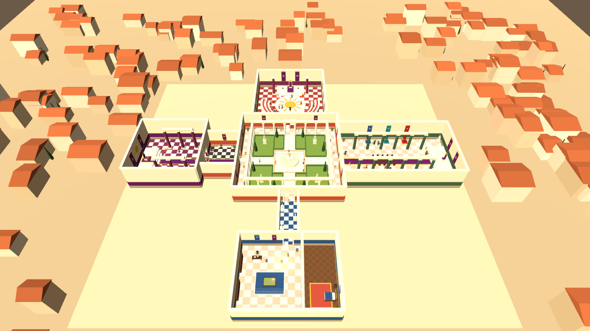
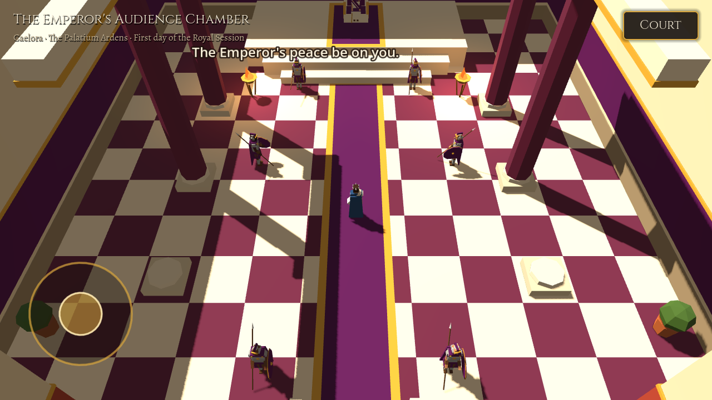
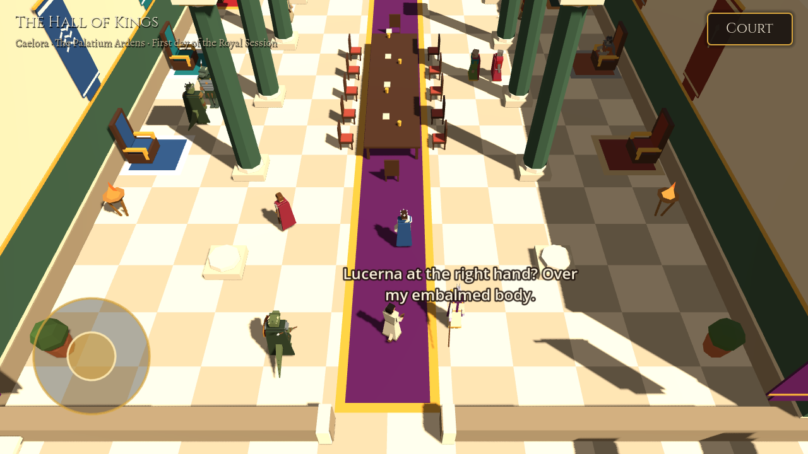
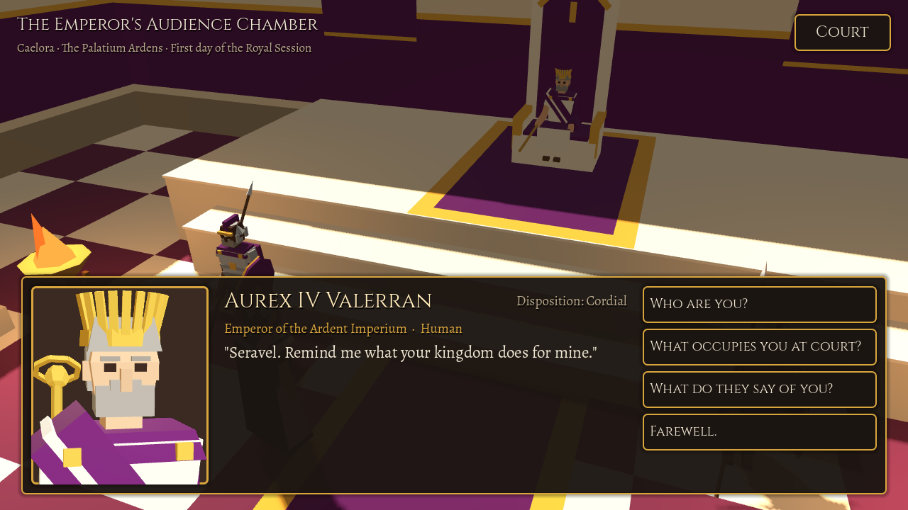
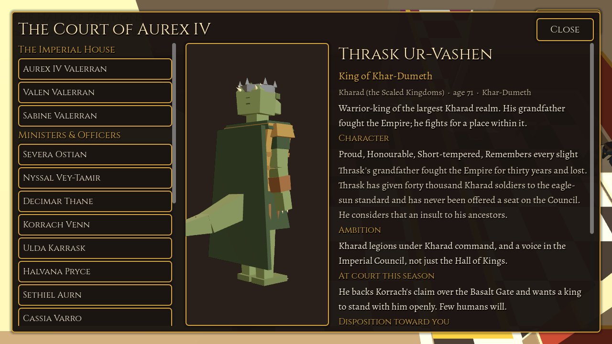

# Imperium: palace prototype

A mobile 3D political RPG. You are the King of Seravel, a client king at the court of an ancient alien empire at the height of its power. This first milestone builds **the characters and the primary rooms**: a walkable, populated imperial palace. The world bible is in [`docs/WORLD.md`](docs/WORLD.md).



| | |
|---|---|
|  |  |
|  |  |

## What's in it
- **18 notable characters and 40 extras** across four species (Human, Veyari, Kharad, Othari). Each is one procedurally built, skinned low-poly mesh on a 17-bone skeleton (one draw call), animated in code: walk, idle, sit, talk gestures, cloak and tail sway.
- **Seven connected rooms**: Peristyle of the Sun, Imperial Council Chamber, Hall of Kings, Hall of Petitions, Emperor's Audience Chamber, Gallery of the River Kings, and the Royal Apartments of Seravel. Around them is a low-poly city of Caelora.
- **A living palace**: notables keep their posts, sit on their thrones or walk routines between rooms along a waypoint graph. Scribes, servants and couriers wander, and nearby characters say overheard lines about court politics.
- **Interaction**: walk up to anyone and press Speak (or tap them to walk over). Dialogue shows a live 3D portrait, a greeting that depends on their disposition toward you, and topics (who they are, their agenda, their realm). The **Court** roster lists everyone with a turntable figure, biography, ambition, current agenda, disposition and whereabouts.
- **Camera**: a third-person high angle, oriented per room (the Audience Chamber looks toward the throne, the Hall of Kings toward the imperial seat). Walls, columns and banners between the camera and you are cut away automatically.

## Controls
Touch: drag the left side of the screen for the joystick, tap a character to approach them, and use the Speak and Court buttons. Pinch to zoom.
Desktop: WASD/arrows to move, E or Space to speak, C or Tab for the court, mouse wheel or +/- to zoom, Esc to close.

## How it's made
Nothing is hand-modelled. `scripts/mesh_builder.gd` emits flat-shaded, vertex-coloured triangles, and everything is built from it: `character_builder.gd` (anatomy per species from `data/species.json`, plus clothing, headwear and props from each character's `look`) and `palace.gd` (an architecture kit of walls with doors, columns, daises, thrones, banners with kingdom emblems, fountains and statues made from character meshes in marble). Content lives in `data/*.json`. Each room's static geometry is merged into one mesh, and the cut-away pieces are separate meshes.

Engine: Godot 4.6, GL Compatibility renderer (mobile), landscape.

## Run & test
```
godot --path imperium                    # play
imperium/tools/run_tests.sh              # headless smoke test: data references, navigation reachability, population
imperium/tools/run_tests.sh --shots      # also render the screenshot tour into tests/screenshots/
godot --path imperium res://tests/lineup.tscn -- --out=cast.png [--ids=emperor,thrask] [--close] [--sit]
```

## Next
AI-driven dialogue grounded in each character's data, council meetings, the remaining palace wings (Treasury, military command, diplomatic halls, ministers' offices), and the kingdom map and management loop from the apartments' map table.
